<div align="center">

# Finding Oneself

**Экспериментальная RPG о пони, потерявшей память**


</div>

<div align="center">

## ⬇️ Скачать игру

[](https://drive.google.com/drive/folders/1Z7qweNOrzZihqW9BofF_iBCF-KGE0ifa?usp=drive_link)

**Windows · v0.39 · ~59,3 МБ**

<sub>Архив лежит на Google Drive. Распакуйте и запустите <code>FindingOneself.exe</code>.</sub>

</div>

---

## Содержание

- [О проекте](#о-проекте)
- [Сюжет](#сюжет)
- [Технологический стек](#технологический-стек)
- [Управление](#управление)
- [Архитектура](#архитектура)
- [Системы игры](#системы-игры)
- [Сохранения](#сохранения)
- [Предметы из картинок](#предметы-из-картинок)
- [Инструменты разработчика](#инструменты-разработчика)
- [Структура проекта](#структура-проекта)
- [Статус разработки](#статус-разработки)
- [Как помочь](#как-помочь)
- [Контакты](#контакты)

---

## О проекте

**Finding Oneself** — 2D-RPG на Unity. Пони Трикси просыпается в шахте и ничего не помнит. Ей нужно заново учиться жить, драться и собирать команду — сначала в Вечнозелёном лесу, потом за его пределами.

Проект делает один человек. Часть артов, текстов и кода создаётся с помощью нейросетей — отчасти это эксперимент: насколько они могут помочь соло-разработчику.

## Сюжет

Трикси предстоит:

- заново научиться всему с нуля;
- набить руку в бою;
- собрать отряд по всему миру;
- разобраться, кто она и что с ней произошло.

Вечнозелёный лес — только первая глава.

---

## Технологический стек

| | |
|---|---|
| Движок | Unity 6000.6.4f1 |
| Язык | C# |
| Рендер | Universal Render Pipeline + Light2D |
| UI | Unity UI + TextMeshPro, часть окон — IMGUI |
| DI | VContainer |
| Данные | ScriptableObject, JSON (Newtonsoft.Json и JsonUtility) |
| Тесты | NUnit (EditMode) |
| Нейросети | Stable Diffusion, Claude.ai, DeepSeek |
| Версионирование | Git + GitHub |

---

## Управление

| Действие | Клавиша по умолчанию |
|---|---|
| Инвентарь / экипировка / квесты | `I` / `E` / `J` |
| Закрыть панель, меню настроек | `Esc` |
| Радиальное меню | ПКМ |
| Взаимодействие | ЛКМ |
| Навигация между локациями | стрелки |
| Магический свет / ясновидение | `L` / `F` |
| Разделить стак: пополам / по одному | `Shift` / `Alt` |
| Сортировка инвентаря | `R` |
| Пропуск диалога (удерживать) | `Ctrl` |
| Быстрое сохранение / загрузка | `F5` / `F9` |
| DevTools | `F1` |
| Панель отладки квестов | `F12` |

Все игровые клавиши переназначаются во вкладке «Клавиши» в настройках.

---

## Архитектура

Проект собран на **VContainer**. Статических синглтонов почти не осталось: зависимости приходят через `[Inject]`.

**Порядок работы**

1. `GameLifetimeScope` — корневой скоуп, живёт между сценами. Находит или создаёт менеджеры (настройки, ввод, флаги, события, квесты, сохранения, база предметов и рецептов и т. д.), регистрирует конфиги из `Resources/Configs`.
2. `SceneInjector` на каждой загрузке сцены создаёт дочерний скоуп, регистрирует в нём сценовые компоненты (диалоги, инвентарь, квестовый UI, способности, радиальное меню) и внедряет зависимости во все `MonoBehaviour` сцены.
3. `GameReferences` — кэш ссылок на объекты сцены. Обновляется на `sceneLoaded` и нужен там, где DI недоступен (ScriptableObject, старый код).
4. `GlobalControl` — постоянный объект, который держит подконтроллеры: `SettingsUI`, `EquipmentUIController`, `ObjectInteractionController`, `AbilityController`, `RadialMenuActionHandler`.
5. `UICoordinator` закрывает конфликтующие панели при открытии новой.

Сцена с индексом 0 — главное меню, остальные — игровые. `EditorGameSceneBootstrap` позволяет запускать игровую сцену напрямую из редактора в режимах `NewGame`, `Continue` и `Empty` (меню `Tools → Test → Mode`).

**Слои**

| Слой | Основные классы |
|---|---|
| Ядро и DI | `GameLifetimeScope`, `SceneInjector`, `GameReferences`, `GlobalControl`, `UICoordinator`, `Logger` |
| Данные и сохранения | `SaveSystem`, `SaveBackups`, `SafeFile`, `GamePaths`, `WorldItemTracker`, `SettingsManager` |
| События | `EventManager`, `EventStateManager`, `EventDataManager`, `FlagManager`, `GameEvent`, `EventConverter` |
| Геймплей | `QuestManager`, `DialogueTracker`, `CraftingSystem`, `EquipmentSystem`, `AbilityManager`, `PickupItem` |
| UI | `MenuUIManager`, `SettingsUI`, `InventoryUIManager`, `QuestUI`, `DialogueUI`, `RadialMenu`, `CraftingUI`, `LoadingScreen` |
| Навигация | `LocationNeighbors`, `SceneSlideTransition`, `NavigationArrow` |
| Презентация | `EyeController`, `DialogueCharacterManager`, `FindingOneselfAnimation`, `TintCharacter` |
| Инструменты | `DebuggerWindow`, `DevToolsWindow`, `InGameDevTools`, `LocationCreatorWizard`, редакторы ассетов |

---

## Системы игры

Каждый раздел свёрнут — раскрывайте нужный.

<details>
<summary><b>Событийная система</b></summary>

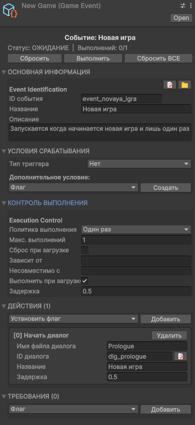

- 12 значений `EventTriggerType` (`PickupItem`, `EnterLocation`, `EquipItem`, `DialogueEnd`, `GlobalFlag`, `Custom` и др.).
- 4 политики выполнения: один раз, несколько раз, раз за сессию, каждый раз.
- 4 типа условий триггера: предмет, локация, флаг, пользовательское.
- 7 типов требований: есть предмет, флаг, локация, событие выполнено, число выполнений, случайный шанс, пользовательское.
- 18 типов действий: диалог, квест, предметы, флаги, телепорт, звук, спавн и удаление объектов, управление другими событиями, группа действий, ветвление `CheckEvent` (if/else).
- Зависимости (`dependsOnEventID`) и взаимные исключения (`mutuallyExclusiveWithEventID`).
- События хранятся как ассеты `GameEvent` в `Resources/Events`. В редакторе есть JSON-копии в `Assets/EventsData` с бэкапами (до 5 на событие); `EventDataRestorer` восстанавливает ассеты из JSON после компиляции.
- Автосохранение в JSON (при входе в Play Mode, компиляции, сохранении сцены и т. д.) настраивается в `EventDataManager` и по умолчанию выключено.
- Сохранённое состояние событий попадает в общий файл сохранения.
- Компоненты для сцены: `EventTriggerWithState`, `SceneEventController`.

Файлы: `EventManager`, `EventStateManager`, `EventDataManager`, `GameEvent`, `EventAction`, `EventContext`, `EventConverter`, `EventDataRestorer`

</details>

<details>
<summary><b>Квесты</b></summary>

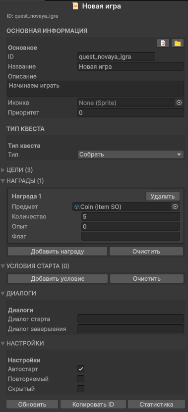
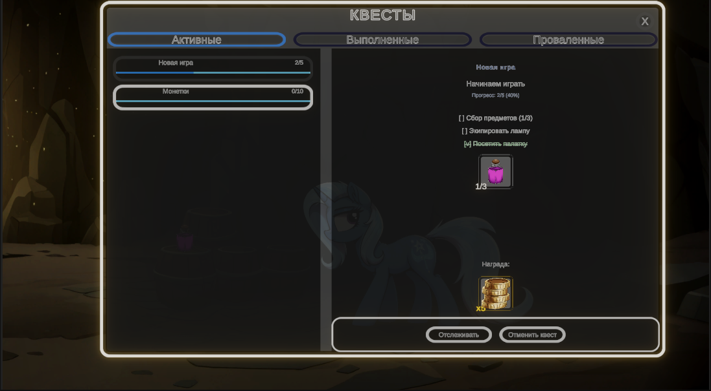

- 8 типов квестов и 6 типов целей (`Collect`, `TalkTo`, `GoTo`, `UseItem`, `Kill`, `Interact`).
- Условия старта: флаги и завершённые квесты. Автостарт и повторяемые квесты.
- Награды: предметы, флаги. Квест не завершается, пока в инвентаре нет места под награду.
- Прогресс обновляется сам: по подобранным и экипированным предметам, посещённым локациям, диалогам.
- Диалоги на старте и на завершении квеста.
- Панель с вкладками «Активные», «Выполненные», «Проваленные», прогресс-бары, отслеживание с уведомлениями о прогрессе, отмена квеста с подтверждением.
- Состояние квестов сохраняется, любое изменение запускает автосохранение.
- `QuestDebugger` — отладочная панель на `F12`.

Файлы: `QuestManager`, `QuestUI`, `QuestInstance`, `QuestSO`, `QuestConfigSO`, `QuestNotifications`, `QuestDebugger`

</details>

<details>
<summary><b>Инвентарь</b></summary>

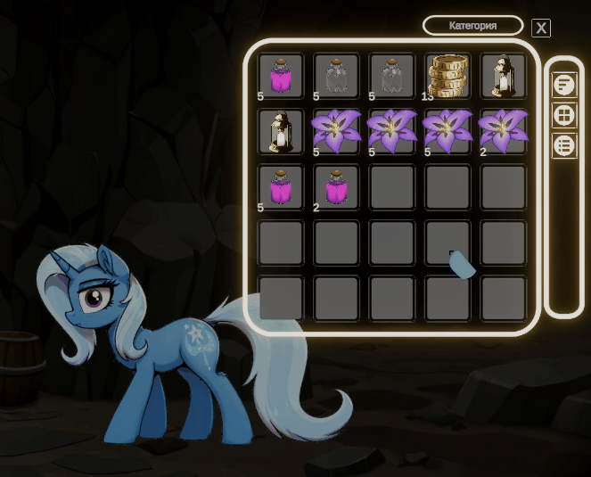

- 30 слотов, перетаскивание, слияние и обмен стаков.
- Разделение стака: `Shift` — пополам, `Alt` — по одному.
- 4 режима сортировки (категория, название, количество, приоритет): клавиша `R` или выпадающий список.
- Контекстное меню по ПКМ, тултипы, панель просмотра предмета (`ItemViewPanel`).
- Предметы описываются `ItemSO` со стабильным строковым `id`. Старый enum `ItemType` оставлен для совместимости и мигрируется через редакторы.
- 9 категорий: ингредиент, расходник, оружие, броня, аксессуар, инструмент, квестовый, валюта, разное.
- Предметы в мире: подбор кликом, перенос перетаскиванием (с лучом от персонажа, а глаза Трикси следят за предметом), выбрасывание из инвентаря с анимацией. Положение выброшенных и перемещённых предметов сохраняется.
- Панель быстрых кнопок: квесты, крафт, заклинания.

Файлы: `InventoryUIManager`, `InventorySlot`, `InventoryItemMarker`, `ItemSO`, `ItemDatabase`, `PickupItem`, `InventorySortDropdown`

</details>

<details>
<summary><b>Крафт</b></summary>

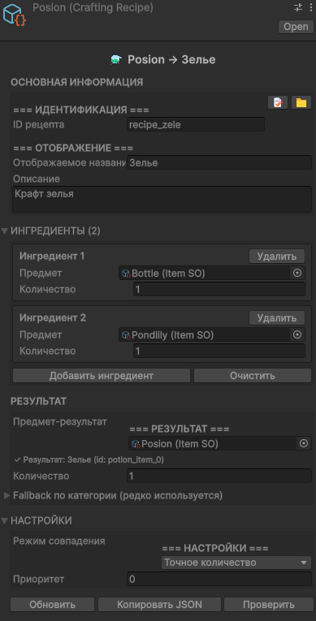
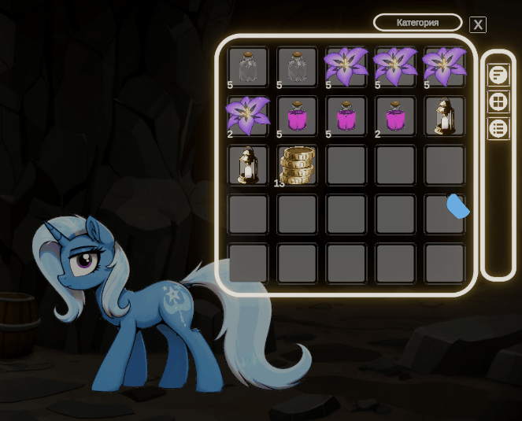

- Рецепты — ScriptableObject (`CraftingRecipe`).
- `RecipeKey` нормализует набор ингредиентов: порядок не важен, дубликаты суммируются.
- Режимы совпадения `ExactCount` и `AtLeastCount`, приоритеты при конфликте рецептов.
- Рецепт изучается после первого успешного крафта; поиск работает только по изученным и подставляет ингредиенты из инвентаря.
- Если в инвентаре нет места под результат, крафт отменяется, ингредиенты не тратятся.

Файлы: `CraftingDatabase`, `CraftingRecipe`, `CraftingSystem`, `CraftingUI`, `CraftingProgress`, `RecipeKey`, `Ingredient`, `CraftSlotUI`

</details>

<details>
<summary><b>Экипировка</b></summary>

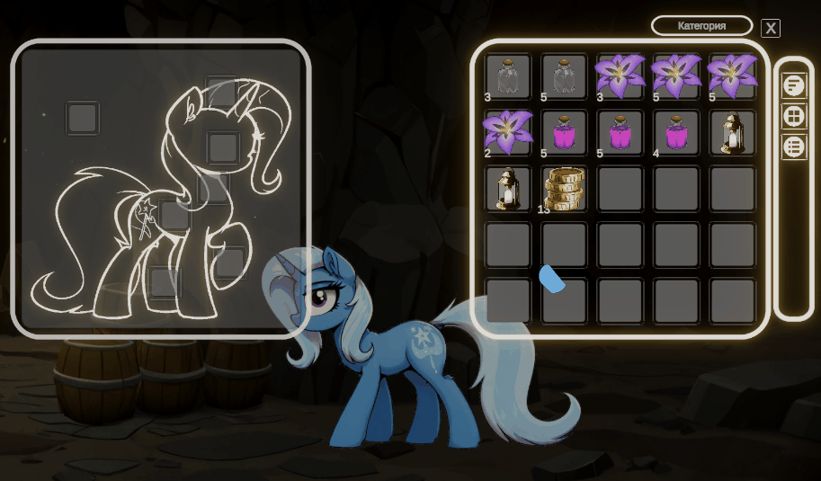

- 11 типов слотов: голова, лицо, шея, грудь, пояс, ноги, обувь, оружие, вторая рука, кольцо, фонарь.
- Экипировка перетаскиванием или через контекстное меню, снятие двойным кликом.
- Предмет появляется на персонаже в точках, найденных по тегу `EquipmentSlot`; коллизии и физика у него отключаются.
- Если инвентарь полон, замена экипировки отменяется.
- Экипировка сохраняется и восстанавливается вместе с инвентарём.

Файлы: `EquipmentSystem`, `EquipmentSlot`, `EquipmentUIController`

</details>

<details>
<summary><b>Диалоги</b></summary>

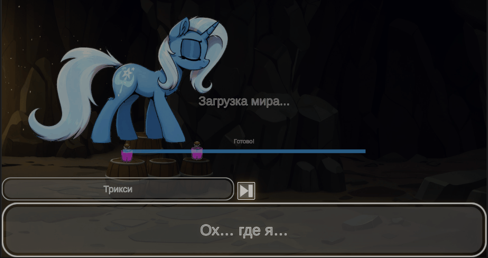

- Диалоги — JSON-файлы в `Resources/Dialogues`: узлы, варианты выбора, действия.
- Локализация по суффиксу файла (`.ru`, `.en`, `.de`) в зависимости от выбранного языка; запасной вариант — русский.
- Условия выбора: `Flag:`, `DialogueCompleted:`, `DialogueNotCompleted:`, `DialogueUnlocked:`, `DialoguePlayCount:`.
- Действия: `SetFlag`, `StartQuest`, `CompleteQuest`, `AddItem`, `CompleteDialogue`, `UnlockDialogue`, `LockDialogue`, `ResetDialogue`, `SetNextDialogue`, `CheckDialogueStatus`.
- `DialogueTracker` помнит статусы: пройден, число прохождений, блокировка, следующий диалог. `DialogueTrigger` умеет цепочки, альтернативы и пулы с случайным выбором.
- Печать текста с настраиваемой скоростью, автопродолжение, кнопка пропуска и пропуск удержанием `Ctrl`.
- Варианты выбора показываются через радиальное меню, при его отсутствии — обычными кнопками.
- Персонажи появляются с fade-анимацией, переходят между локациями и зоной говорящего.

Файлы: `TextBeginner`, `DialogueData`, `DialogueUI`, `DialogueFileManager`, `DialogueCharacterManager`, `DialogueTracker`, `DialogueTrigger`

</details>

<details>
<summary><b>Главное меню и настройки</b></summary>

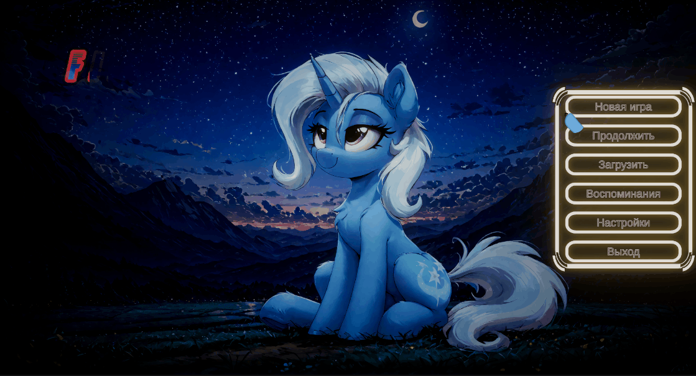

**Меню**

- Анимация букв «Finding Oneself» с мерцающим светом, затем появление Трикси.
- Плавные переходы между панелями и фонами, подтверждение выхода.
- Выбор профиля сохранения: создание, загрузка, перезапись, удаление, превью-скриншот.
- Загрузочный экран с прогрессом.
- Внешний вид меню настраивается в `MenuUIConfig`.

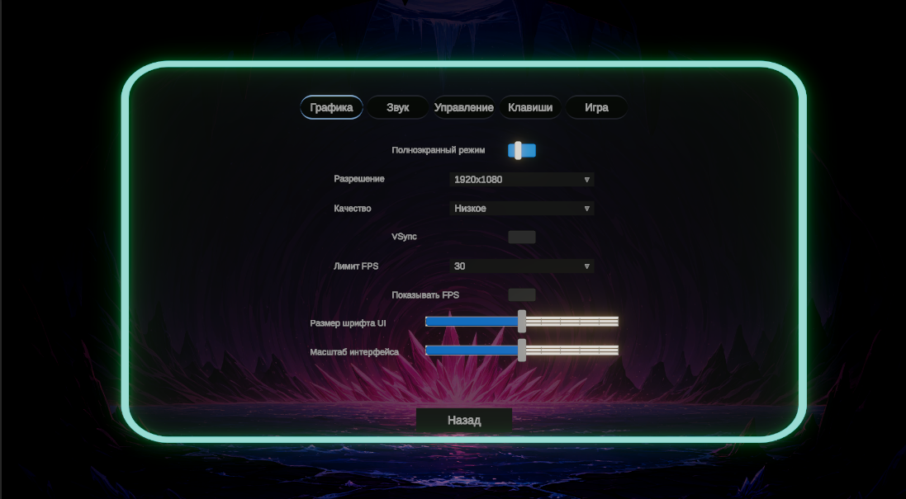
**Настройки** (доступны и в игре по `Esc`), 5 вкладок:

- Графика: полный экран, разрешение, качество, VSync, лимит FPS, счётчик FPS, размер шрифта и масштаб интерфейса.
- Звук: общая громкость применяется сразу; музыка, звуки и голос сохраняются в настройках.
- Управление: схема управления.
- Клавиши: переназначение всех игровых клавиш.
- Игра: язык, сложность, автосохранение, скорость текста, автодиалог, подсказки.

Также есть фильтр для дальтоников (три режима через URP Channel Mixer).

Файлы: `MenuUIManager`, `MenuUIConfig`, `SettingsUI`, `TabManager`, `SaveSelectionPanel`, `BackgroundManager`, `FindingOneselfAnimation`, `LoadingScreen`

</details>

<details>
<summary><b>Радиальное меню</b></summary>

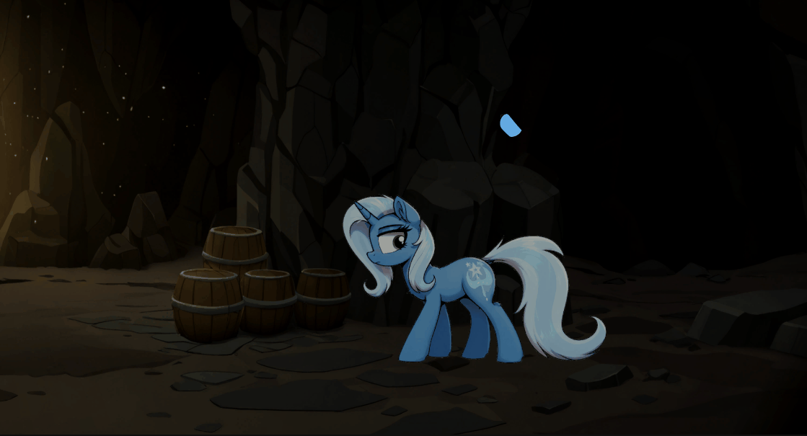

- Три роли, определяемые тегом: главное меню (`RadialMenu`), выбор в диалоге (`ChoicePanel`), контекстное меню предмета (`ContextMenu`). `RadialMenuRegistry` находит их при загрузке сцены.
- 4 раскладки: круг, веер, вертикальная, горизонтальная.
- Главное меню: инвентарь, экипировка, магический свет, настройки, выход в меню, выход из игры.
- Контекстное меню предмета: использовать, экипировать или снять, разделить, осмотреть, выбросить. Набор кнопок зависит от свойств `ItemSO`.
- Открывается по ПКМ, не открывается во время диалога и поверх слотов инвентаря.
- Кнопки берутся из пула; если префабы в `Resources` не найдены, создаются запасные.

Файлы: `RadialMenu`, `RadialButton`, `RadialMenuController`, `RadialMenuActionHandler`, `RadialMenuOpener`, `RadialMenuRegistry`, `MenuCloseHandler`

</details>

<details>
<summary><b>Навигация</b></summary>

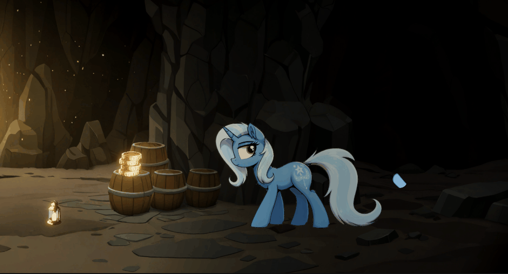

- Соседи локации определяются автоматически по позиции (учитываются угол и максимальная дистанция) или задаются вручную в инспекторе.
- Переход между локациями со слайд-анимацией, управление стрелками.
- Персонаж переезжает вместе с локацией и встаёт в точку `LocationReference`.
- Событие `OnSceneChanged` и триггер `EnterLocation`.
- Стрелки-подсказки `NavigationArrow` видны только пока включено ясновидение.
- `SceneTransition` — fade между сценами.

Файлы: `LocationNeighbors`, `NavigationArrow`, `LocationArrows`, `SceneSlideTransition`, `SceneTransition`

</details>

<details>
<summary><b>Способности</b></summary>

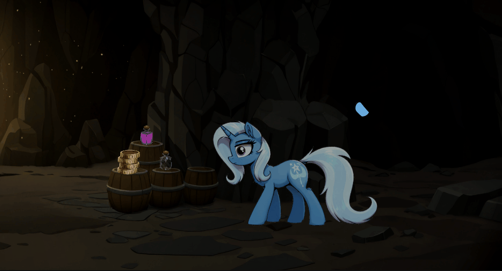

- Базовый класс `Ability`: кулдаун, стоимость энергии. `AbilityManager` собирает способности из дочерних объектов и управляет частицами персонажа.
- **Магический свет**: луч следует за курсором, Light2D, пульсация, след из частиц, поиск объектов в радиусе. Глаза персонажа реагируют на свет.
- **Ясновидение**: включает навигационные стрелки и эффект частиц.
- Панель заклинаний `MagicSpellPanel` строится сама по списку зарегистрированных способностей.

Файлы: `Ability`, `AbilityManager`, `MagicLightAbility`, `ClairvoyanceAbility`, `MagicSpellPanel`

</details>

<details>
<summary><b>Глаза персонажа и освещение</b></summary>


`EyeController` делится на три подсистемы: `EyeLookController`, `EyeBlinkController`, `EyeLightController`.

- Автопоиск частей глаза по именам в иерархии.
- Движение радужки внутри эллипса со своими границами для каждого состояния (обычный, прищур, широко открытый, полузакрытый).
- Блуждание взгляда на Perlin-шуме и саккадах, слежение за курсором или произвольной целью.
- Перспективное сжатие радужки.
- Зрачок реагирует на ближайшие Light2D и магический свет; от яркого света глаза прищуриваются, с гистерезисом на вход и выход.
- Случайное моргание, двойное моргание, ручные вызовы.
- `TintCharacter` подкрашивает спрайты персонажа под освещение текущей локации.

Файлы: `EyeController`, `EyeLookController`, `EyeBlinkController`, `EyeLightController`, `TintCharacter`

</details>

---

## Сохранения

<details>
<summary><b>Как устроено</b></summary>

Всё состояние игры лежит в одном файле на профиль: `Save/<профиль>/Game/save.sv` (JSON, версия формата 2).

В файле: инвентарь, экипировка, текущая локация, флаги, квесты (активные, завершённые, отменённые), предметы в мире (подобранные, выброшенные, перемещённые), состояния событий, статусы диалогов, изученные рецепты, скриншот-превью.

**Где лежит `Save/`:** в корне проекта в редакторе, в `Application.persistentDataPath` в билде.

| Файл | Назначение |
|---|---|
| `Save/Settings/settings.json` | Настройки игрока, общие для всех профилей |
| `Save/<профиль>/Game/save.sv` | Основное сохранение |
| `save.sv.bak` | Предыдущая версия основного файла |
| `Game/Backups/*.sv` | Бэкапы: перед каждым сохранением и при выходе из игры (до 10) |
| `Assets/EventsData/*.json` | JSON-копии событий (только редактор) |

**Надёжность**

- Запись идёт через временный файл и `.bak` (`SafeFile`): при повреждении основного файла читается резервная копия.
- Выход из игры пишет снимок только в `Backups`, основной файл не трогает.
- Профили — отдельные папки. Имя: латиница, цифры, `_`, до 20 символов.

**Когда сохраняется**

- `F5`, по завершении диалога, при изменении состояния квестов (с задержкой 1,5 с).
- Загрузка — `F9`, «Продолжить» или выбор профиля в меню.

</details>

---

## Предметы из картинок

<details>
<summary><b>Добавление предметов без Unity</b></summary>

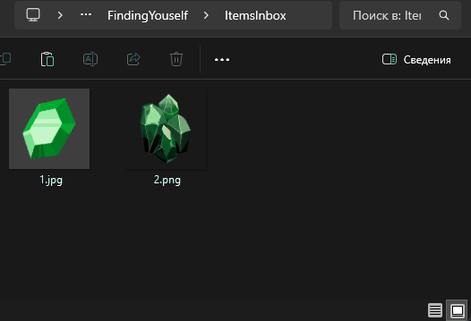

Художник кладёт PNG или JPG в папку `ItemsInbox` рядом с игрой (в редакторе — в корень проекта), и игра сама собирает из него полноценный предмет: иконку в инвентаре, спрайт на земле, запись в `ItemDatabase`.

- Папка опрашивается раз в 1,5 секунды: новые и изменённые файлы подхватываются без перезапуска.
- Имя файла становится названием, а его транслит — `id` (`Красный цветок.png` → `krasnyy_tsvetok`). Переименование файла создаёт новый предмет.
- Размер иконки и спрайта в мире считается так же, как у обычных предметов.
- Подпапка с именем категории (`ItemsInbox/Ingredient/...`) задаёт категорию.
- Рядом можно положить `.json` с тем же именем: название, описание, категория, стак, экипировка, цвет подсветки, размеры, теги, характеристики. Все поля необязательны.
- Максимальный размер картинки — 512×512 px. Более крупные файлы не загружаются, причина видна в DevTools.
- Предметы живут только в рантайме, ассетами проекта не становятся.

Подробности: [`Scripts/RuntimeItems/README_Предметы_из_картинок.md`](Assets/Scripts/RuntimeItems/README_Предметы_из_картинок.md)

</details>

---

## Инструменты разработчика

<details>
<summary><b>Внутриигровой DevTools (F1)</b></summary>

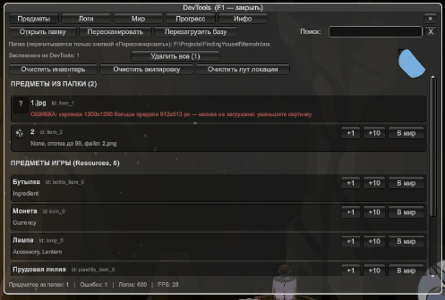

Окно на IMGUI, работает и в билде. Пока открыто, игровой ввод заблокирован.

| Вкладка | Что умеет |
|---|---|
| Предметы | Выдать в инвентарь, поставить в мир, поиск, пересканировать `ItemsInbox`, удалить всё заспавненное |
| Логи | Фильтры по модулям, только ошибки или предупреждения, поиск, размер шрифта, экспорт в файл |
| Мир | Телепорт по локациям |
| Прогресс | Завершить или отменить квест, просмотр и переключение флагов |
| Инфо | Пути папок, ошибки `ItemsInbox`, версия Unity, сцена, verbose-логи |

</details>

<details>
<summary><b>Редакторские инструменты</b></summary>

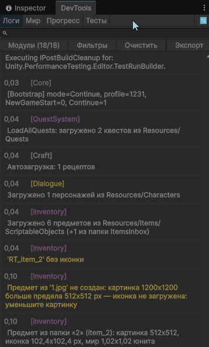
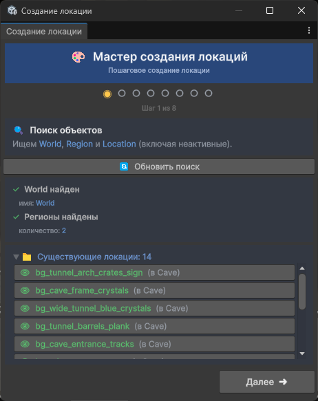

| Инструмент | Назначение |
|---|---|
| `LocationCreatorWizard` | Пошаговое создание локации (8 шагов): регион, спрайт и имя, позиция, точка появления персонажа, источники света, предметы |
| `DevToolsWindow` | `Tools → DevTools`: логи, телепорт, спавн предметов, квесты и флаги, запуск тестов с описанием каждого |
| `DebuggerWindow` | Отдельное окно логов (`Tools → Личное Окно Отладки`) |
| `QuestSOEditor` | Редактор квестов |
| `GameEventEditor` | Редактор событий с вложенными действиями |
| `ItemSOEditor` | Редактор предметов, быстрое создание UI и World префабов по иконке |
| `CraftingRecipeEditor` | Редактор рецептов с проверкой и миграцией legacy-полей |
| `QuestConfigEditor`, `MenuUIConfigEditor`, `DialogueDataEditor` | Редакторы конфигов по разделам |
| `InputManagerEditor` | Правка `InputConfig` по категориям |
| `EventDataRestorer`, `EventEditorHelper` | Восстановление событий из JSON, меню `Tools → Система событий` |
| `IdEditorHelper`, `IdGenerator` | Генерация ID, массовая генерация через `Tools → Миграция` |
| `TestModeMenu` | Режим запуска игровой сцены из редактора |

</details>

<details>
<summary><b>Логирование и отладка</b></summary>

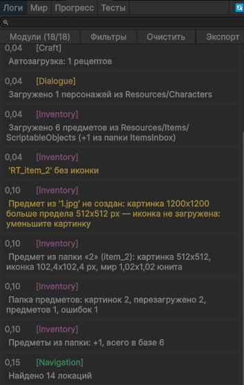

`Logger` делит логи на 18 модулей (`Core`, `DI`, `UI`, `Dialogue`, `Event`, `Inventory`, `Craft`, `Menu`, `Navigation`, `QuestSystem`, `RadialMenu`, `Abilities`, `Audio`, `Animation`, `Save`, `Editor`, `Tests`, `Debug`).

- Методы `Log`, `LogWarning`, `LogError`, `LogVerbose`.
- Модули включаются и выключаются через `SetModuleEnabled()`, подробный режим — через `SetVerbose()`.
- Окна отладки показывают модуль, время, стек ошибок и умеют фильтровать и экспортировать логи.
- Внутриигровой буфер `RuntimeLogBuffer` собирает логи в билде для окна DevTools.

Использование:

```csharp
Logger.Log(LogModule.Inventory, "Предмет добавлен");
```

</details>

<details>
<summary><b>Тесты</b></summary>

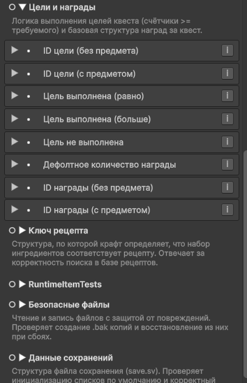

20 тестовых классов EditMode (NUnit) в `Scripts/Editor/Tests`. Запускаются через Test Runner или вкладку «Тесты» в `DevToolsWindow`.

Покрыто: ключи и поиск рецептов, ингредиенты, прогресс и завершение квестов, условия старта квестов, `QuestManager`, контекст и сериализация событий, структура сохранения и его JSON round-trip, `SafeFile`, `KeyBindings`, `Logger`, генерация ID, `ItemSO`, предметы из картинок.

</details>

---

## Структура проекта

<details>
<summary><b>Развернуть дерево</b></summary>

```
finding-oneself/
├── Assets/
│   ├── Scripts/
│   │   ├── Abilities/       способности, панель заклинаний, визуал подбора предметов
│   │   ├── DI/              GameLifetimeScope, SceneInjector, RadialMenuRegistry, EditorGameSceneBootstrap
│   │   ├── Dialogue/        TextBeginner, DialogueUI, DialogueTracker, DialogueTrigger и др.
│   │   ├── Event/
│   │   │   ├── Actions/
│   │   │   ├── Components/
│   │   │   ├── Conditions/
│   │   │   ├── Core/
│   │   │   ├── Integration/
│   │   │   ├── Serialization/
│   │   │   └── State/
│   │   ├── Eyes/            контроллер глаз и его подсистемы
│   │   ├── Inventory/
│   │   │   └── Craft/
│   │   ├── Menu/            фоны меню, анимация заставки
│   │   ├── Navigation/
│   │   ├── QuestSystem/
│   │   ├── RadialMenu/
│   │   ├── RuntimeItems/    предметы из картинок и внутриигровой DevTools
│   │   ├── Save/            SaveSystem, SaveData, SaveBackups, SaveSelectionPanel
│   │   ├── Settings/        настройки, ввод, меню и окно настроек
│   │   │   └── UI/
│   │   ├── Editor/
│   │   │   ├── Creator/
│   │   │   ├── Debugger/
│   │   │   └── Tests/
│   │   └── *.cs             GlobalControl, GameReferences, GamePaths, Logger,
│   │                        SafeFile, UICoordinator, LoadingScreen и др.
│   ├── Resources/
│   │   ├── Configs/
│   │   ├── Dialogues/
│   │   ├── Events/
│   │   ├── Items/
│   │   ├── Quests/
│   │   └── UI/
│   ├── Scenes/
│   └── EventsData/
│       └── Backups/
├── Save/                    создаётся при запуске (в билде — в persistentDataPath)
├── ItemsInbox/              PNG-предметы художника
```

</details>

---

## Статус разработки

| Система | Статус |
|---|---|
| Передвижение и взаимодействие | Готово |
| Событийная система | Готово |
| Квесты | Готово |
| Инвентарь, крафт, экипировка | Готово |
| Диалоги | Готово |
| Радиальное меню | Готово |
| Главное меню, настройки, переназначение клавиш | Готово |
| Сохранения с профилями | Готово |
| Навигация по локациям | Готово |
| Способности (магический свет, ясновидение) | Готово |
| Глаза персонажа | Готово |
| Предметы из картинок | Готово |
| Инструменты разработчика и тесты | Готово |
| Локализация интерфейса | Частично: диалоги поддерживают `ru/en/de`, тексты интерфейса пока на русском |
| Прокачка | Планируется |
| Система отряда | Планируется |
| Боевая система | Планируется |
| Множество локаций | Планируется |

<details>
<summary><b>Цифры</b></summary>

| Метрика | Значение |
|---|---|
| Версия | 0.39 |
| Сервисов в корневом DI-скоупе | 20 |
| Типов ScriptableObject | 8 (`ItemSO`, `QuestSO`, `GameEvent`, `CraftingRecipe`, `QuestConfigSO`, `DialogueData`, `InputConfig`, `MenuUIConfig`) |
| Модулей логирования | 18 |
| Тестовых классов | 20 |

</details>

---

## Как помочь

Идеи по сюжету, механикам и квестам, арт и спрайты, код и багфиксы, тестирование и фидбек. Присоединяйтесь через Pull Request или пишите в Telegram.

**Автор:** Walderman, соло-разработчик.

---

## Ссылки

- [GitHub](https://github.com/Walderman1)
- [Telegram](https://t.me/FindingOneselfGame)

---

<div align="center">

> «Даже если ты потерял память, ты всегда можешь найти себя заново.»
> — Трикси

Если проект нравится, поставьте звезду на GitHub.

</div>
